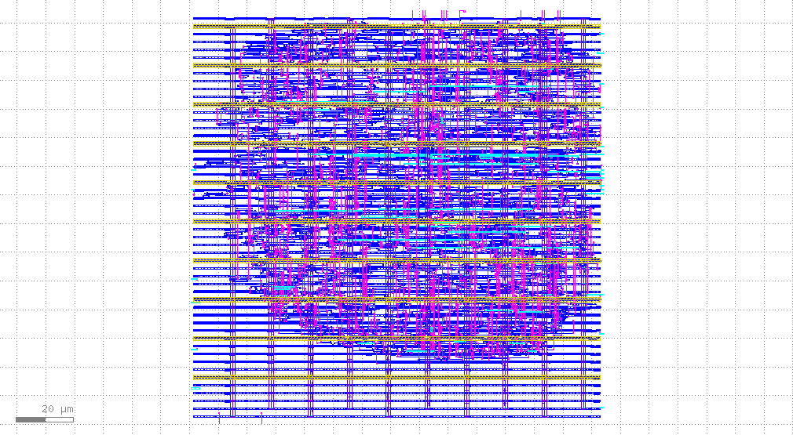
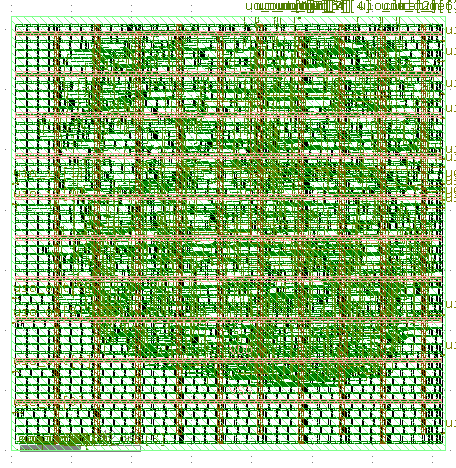

# QEM-01 — Quadrature Encoder Position and Speed Monitor

A Verilog-based quadrature encoder monitoring system taken through an RTL-to-GDS implementation flow using the SKY130HD standard-cell library.

## Overview

QEM-01 monitors incremental rotary encoder signals and provides:

- 4× quadrature decoding
- 32-bit signed position tracking
- Saturating position counter with sticky overflow status
- Speed measurement over a 10 ms window
- Invalid-transition detection and sticky error reporting
- Snapshot-based measurement readback
- Register-based control and status interface

**Target technology:** SkyWater SKY130HD  
**Clock frequency:** 50 MHz  
**Implementation flow:** Yosys, OpenROAD, and KLayout

## Architecture
```
Encoder A/B
    |
    v
Input Synchronizer
    |
    v
Quadrature Decoder
    |
    v
+----------------------+
|     Encoder Core     |
|                      |
|  Position Counter    |
|  Speed Counter       |
|  Error Status        |
+----------------------+
    |
    v
Register Bank
    |
    v
QEM Top
    |
    v
TinyTapeout Wrapper
```
 
## Design Specifications

| Feature | Implementation |
|---|---|
| Encoder type | Incremental quadrature |
| Decoding | 4× |
| Encoder inputs | A and B |
| Input synchronization | Two-stage |
| Position | 32-bit signed |
| Position behavior | Saturating |
| Speed measurement | Transitions per 10 ms |
| Speed counter | 16-bit |
| Error handling | Sticky invalid-transition status |
| Reset | Active-low asynchronous |
| System clock | 50 MHz |

## RTL Modules

| File | Description |
|---|---|
| `input_synchronizer.v` | Synchronizes asynchronous encoder inputs |
| `quadrature_decoder.v` | Decodes direction and detects invalid transitions |
| `encoder_frontend.v` | Connects synchronizer and decoder |
| `position_counter.v` | Position tracking, saturation, and overflow |
| `speed_counter.v` | Fixed-window transition counting |
| `encoder_core.v` | Integrates encoder processing |
| `qem_register_bank.v` | Snapshot, control, and status registers |
| `qem_top.v` | Top-level integration |
| `tt_um_qem01.v` | TinyTapeout-compatible wrapper |

## Verification

RTL simulation was performed using Icarus Verilog.

Verified behavior includes:

- Forward and reverse quadrature sequences
- Invalid-transition detection
- Sticky error assertion and clearing
- Position increment and decrement
- Positive and negative position saturation
- Overflow indication and position clearing
- Speed measurement over a reduced simulation window

The complete RTL hierarchy was also checked using Yosys.

## Physical Implementation

### Final Layout — SKY130HD



*Post-route GDS layout showing the standard-cell interconnect across the SKY130HD metal layers.*

<details>
<summary>View complete layer layout</summary>



</details>

The design was implemented using OpenROAD Flow Scripts and the SKY130HD platform.

| Metric | Result |
|---|---:|
| Die dimensions | 144.47 × 144.47 µm |
| Core area | 19,653.85 µm² |
| Final cell area | 9,081 µm² |
| Final utilization | 46% |
| Clock sinks | 143 |
| Clock buffers | 17 |
| Detailed-route nets | 874 |
| Detailed-route wirelength | 17,564 µm |
| Vias | 5,968 |

### Synthesis

| Metric | Result |
|---|---:|
| SKY130HD mapped cell count | 603 |
| Mapped cell area | 6,650.128 µm² |
| Flip-flops | 143 |
| Sequential cell area | 3,578.432 µm² |

### Post-route timing

| Metric | Result |
|---|---:|
| Clock period | 20 ns |
| Worst setup slack | +13.79 ns |
| Worst hold slack | +0.35 ns |
| Setup TNS | 0 ns |

### Physical verification

| Check | Result |
|---|---|
| OpenROAD detailed-route DRC | 0 violations |
| KLayout SKY130HD DRC | 0 violations |
| Antenna violations | 0 |
| Net violations | 0 |
| Pin violations | 0 |
| LEF–GDS cell matching | Passed |
| Orphan GDS cells | None |

## Repository Structure

```text
QEM-01/
├── README.md
├── docs/
│   ├── specification.md
│   ├── architecture.md
│   └── physical_design.md
├── rtl/
├── tb/
├── images/
│   ├── Layout.png
│   └── Layout_met.png
├── reports/
│   ├── drc/
│   ├── physical_design/
│   └── sky130_synthesis_stat.txt
└── results/
    ├── def/
    ├── gds/
    └── parasitics/
```

## Tools

- Verilog HDL
- Icarus Verilog
- GTKWave
- Yosys
- OpenROAD
- OpenSTA
- SKY130HD standard-cell library
- KLayout

## Limitations

- LVS has not been performed.
- The design has not been fabricated or silicon-tested.
- Timing results are based on the configured SDC and analysis corner.
- Encoder inputs use two-stage synchronization without a separate glitch filter.
- Speed is reported as transitions per 10 ms, not directly as RPM.
- The register interface assumes a synchronous external controller.


